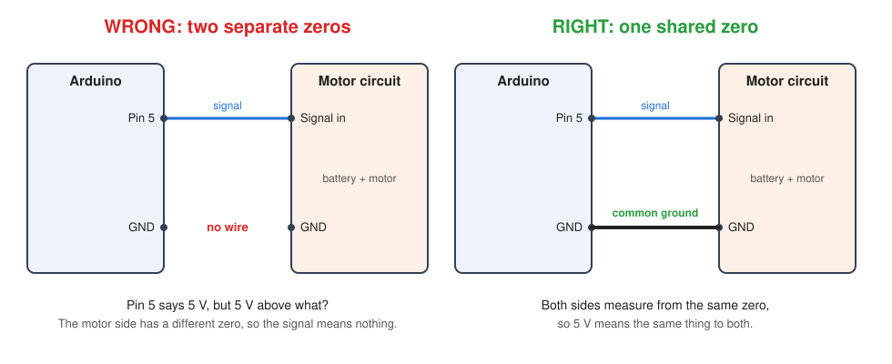
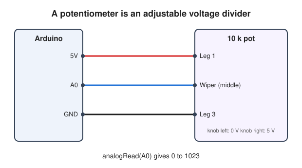
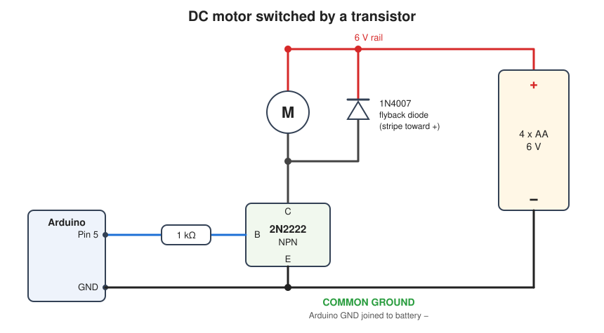
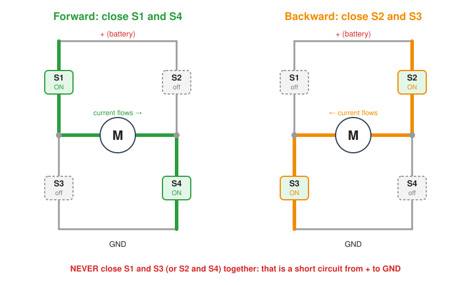
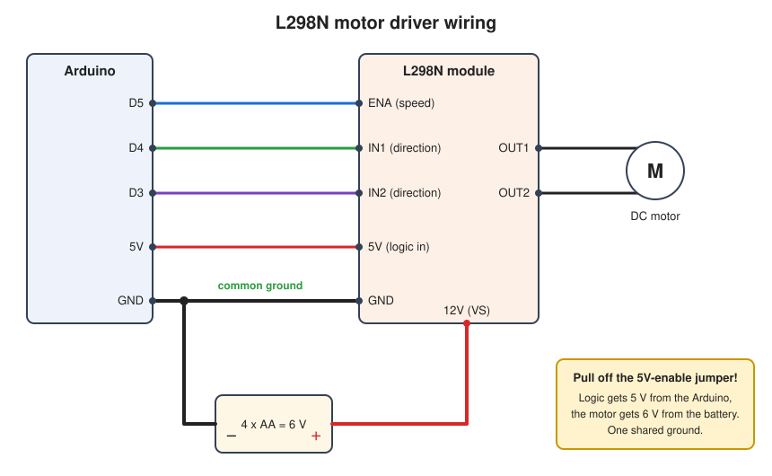
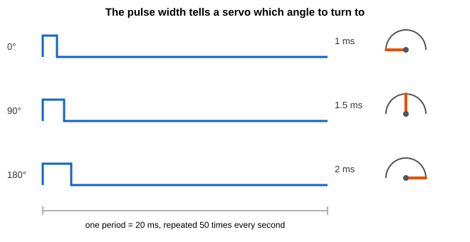
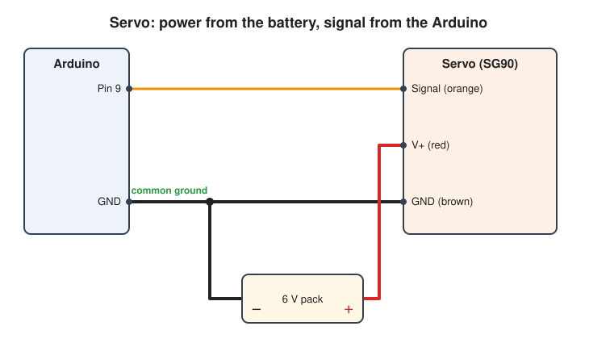
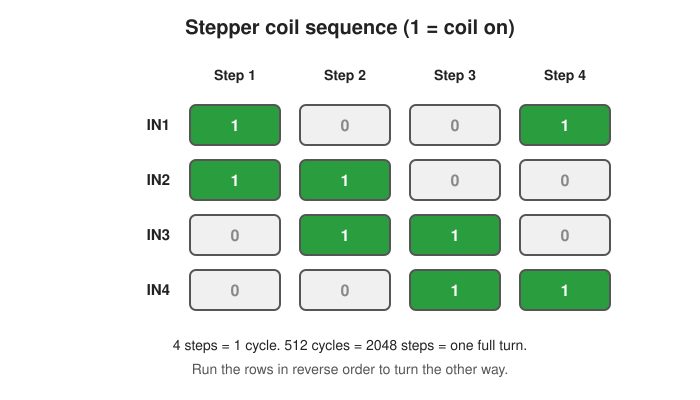
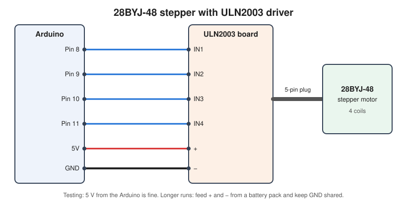
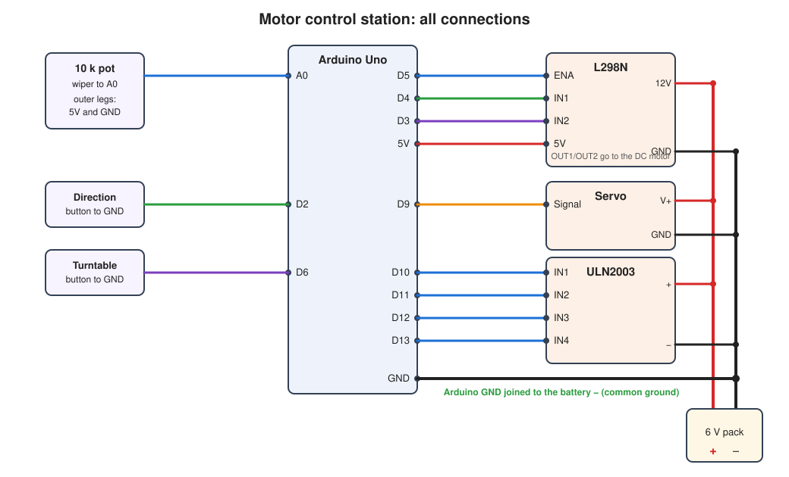

# Motors and actuators: DC motors, servos and steppers

So far your Arduino has *sensed* the world and *lit up* LEDs. Now it gets to **move things**. In this guide you'll learn three kinds of motor: the plain **DC motor** that spins freely, the **servo** that turns to an exact angle, and the **stepper** that turns in tiny, countable steps. Before any of that, you'll learn the idea that decides whether your project works or smokes: **power and common ground**.

The code is written for an Arduino Uno. The circuit diagrams are in the `circuits/` folder next to this file.

## What you need

- Arduino Uno and a USB cable
- Breadboard and jumper wires
- A small hobby DC motor (3 to 6 V)
- 2N2222 (or PN2222) NPN transistor, a 1 kΩ resistor and a 1N4007 diode
- L298N motor driver module
- A small hobby servo (SG90 or similar)
- 28BYJ-48 stepper motor with ULN2003 driver board
- 10 kΩ potentiometer
- Two push buttons
- Battery holder with 4 AA batteries (about 6 V)
- A multimeter (strongly recommended)

---

## Part 0: Power and common ground from first principles

Most motor problems are power problems. Spend ten minutes here and the rest of the guide gets much easier.

### Voltage, current and resistance: the water picture

Imagine a water pump pushing water round a loop of pipe.

- **Voltage (V, volts)** is the *pressure* the pump creates. A battery is the pump.
- **Current (I, amps)** is the *flow* of water. Motors care a lot about this.
- **Resistance (R, ohms)** is how narrow the pipe is. A narrow pipe lets less flow through.

They are tied together by Ohm's law:

```
I = V / R
```

Example: an LED with a 220 Ω resistor on 5 V. The LED itself uses about 2 V, so the resistor sees 3 V.

```
I = 3 V / 220 Ω = 0.0136 A = about 14 mA
```

That is a gentle trickle, and an Arduino pin is happy to supply it.

### Why an Arduino pin can't drive a motor

An Arduino Uno pin is designed to supply about **20 mA** (the absolute limit is 40 mA). A small DC motor spinning freely might draw **200 mA**, and **500 mA or more** if you hold the shaft still.

```
250 mA motor / 20 mA per pin = 12 pins needed for one motor
```

Driving a motor straight from a pin is like trying to fill a swimming pool through a drinking straw. It can damage the pin, or the whole chip.

The solution is to let the Arduino *control* a switch, while a separate **power source** supplies the heavy current. The Arduino sends a small signal, and a bigger circuit does the heavy lifting. A transistor or a motor driver is that switch.

### What is ground, really?

Voltage is never a property of one point. It is always a **difference between two points**, the same way height is only meaningful compared to some zero. We usually measure heights from sea level, but that is just an agreement.

In electronics, **ground (GND)** is the agreed zero. When we say a pin is at 5 V, we mean it is 5 V *higher than ground*. Ground is not magic, and it doesn't have to be the actual earth. It's just the wire everyone agrees to measure from.

### The big idea: common ground

Now imagine two separate circuits:

- The Arduino, powered by USB, with its own ground.
- A battery pack for the motor, with its own ground.

If these two grounds are **not connected**, each circuit has its own private zero. The Arduino says "my pin is 5 V", but 5 V *above what*? The motor side has no idea where the Arduino's zero is, so the signal means nothing to it.



**Rule: whenever two power sources share a circuit, connect their grounds together.** Only the grounds. Never connect the + of one supply to the + of another.

> **Try it with a multimeter.** Set it to DC volts.
> 1. Measure across the battery pack: about 6 V.
> 2. Measure from the Arduino 5V pin to the battery's − terminal with the grounds *not* joined. The reading is unstable and meaningless.
> 3. Join Arduino GND to battery −. Measure again: a steady 5 V.
>
> Same wires, but now they share a zero.

### Two more power ideas you'll meet

**Motors fight back.** A spinning motor is also a tiny generator. When you switch it off, the coil inside produces a sudden voltage spike in the opposite direction (called back-EMF) that can be many times the supply voltage. That can destroy a transistor. A **flyback diode** across the motor gives the spike a safe path. You'll add one in Part 1.

**Motors cause electrical noise and voltage dips.** When a motor starts, it gulps current and the supply voltage briefly sags. If the Arduino shares that supply, it can reset. That's why we use a separate battery pack for the motor rail, and why a small capacitor across the motor is often added.

### Power plan used in this guide

```
USB          -->  Arduino      (the brain: logic and signals)
4 x AA (6 V) -->  motors       (the muscle: heavy current)
Arduino GND  ---- Battery −    (the common ground that joins them)
```

### Reading a potentiometer (used throughout)

You'll use a pot as a knob in several circuits. It's a voltage divider: the middle leg (the wiper) slides between 0 V and 5 V as you turn it.



---

## Part 1: DC motors

### What's a DC motor?

A DC motor spins when you give it power. Reverse the power and it spins the other way. Inside, current flows through coils that become electromagnets, pushing against permanent magnets so the shaft turns.

- **More voltage = faster.**
- **Reverse the polarity = reverse direction.**
- **No idea where the shaft is pointing.** That's the big difference from a servo.

DC motors suit fans, wheels, pumps, and anything that just needs to spin.

### Circuit 1: Switching a motor with a transistor

The transistor is an electrically controlled switch. A tiny current into the **base** lets a big current flow from the **collector** to the **emitter**.



What each part does:

- **1 kΩ resistor:** limits the current from the Arduino pin into the base.
- **1N4007 diode:** the flyback diode. It sits across the motor with the *stripe towards the + side*. Normally it does nothing. When the motor switches off, it absorbs the spike.
- **Common ground:** the emitter joins both the Arduino GND and the battery −.

### Code: on and off

```cpp
int motorPin = 5;

void setup() {
  pinMode(motorPin, OUTPUT);
}

void loop() {
  digitalWrite(motorPin, HIGH);   // motor on
  delay(2000);
  digitalWrite(motorPin, LOW);    // motor off
  delay(2000);
}
```

### Code: speed control with PWM and a potentiometer

PWM switches the motor on and off very fast. The longer it stays on in each cycle, the faster the motor runs. Pin 5 supports PWM. Wire the pot as shown in Part 0.

```cpp
int motorPin = 5;
int potPin = A0;

void setup() {
  pinMode(motorPin, OUTPUT);
  Serial.begin(9600);
}

void loop() {
  int potValue = analogRead(potPin);              // 0 to 1023
  int speed = map(potValue, 0, 1023, 0, 255);     // 0 to 255

  analogWrite(motorPin, speed);

  Serial.println(speed);
  delay(20);
}
```

It's the same pattern as the LED dimmer: **read a knob, scale the number, send it to an output.** Notice the motor won't start turning until the speed is fairly high. It needs enough push to overcome friction.

### The problem: this motor only goes one way

To reverse a motor you must flip the polarity: + on the other terminal. The trick is an **H-bridge**: four switches arranged like the letter H with the motor in the middle.



You don't build this from scratch. The **L298N** module contains two H-bridges with all the protection built in.

### Circuit 2: L298N motor driver



**Important:** pull the small jumper off the L298N's 5V-enable pins, and feed 5 V from the Arduino into the 5V terminal. This module's built-in regulator needs a higher input voltage than our 6 V pack can give. We are powering its *logic* from the Arduino and its *motor* from the battery: two separate jobs, two separate supplies, one common ground.

How the direction pins work:

| IN1 | IN2 | Motor |
| --- | --- | ----- |
| HIGH | LOW | Forward |
| LOW | HIGH | Backward |
| LOW | LOW | Stop (coasts) |
| HIGH | HIGH | Stop (brakes) |

ENA sets the speed with `analogWrite()`. Be aware the L298N wastes about 2 V as heat, so a 6 V pack gives the motor about 4 V.

### Code: forward, stop, backward

```cpp
int enaPin = 5;
int in1Pin = 4;
int in2Pin = 3;

void setup() {
  pinMode(enaPin, OUTPUT);
  pinMode(in1Pin, OUTPUT);
  pinMode(in2Pin, OUTPUT);
}

void loop() {
  // Forward at full speed
  digitalWrite(in1Pin, HIGH);
  digitalWrite(in2Pin, LOW);
  analogWrite(enaPin, 255);
  delay(2000);

  // Stop
  analogWrite(enaPin, 0);
  delay(1000);

  // Backward at half speed
  digitalWrite(in1Pin, LOW);
  digitalWrite(in2Pin, HIGH);
  analogWrite(enaPin, 128);
  delay(2000);

  analogWrite(enaPin, 0);
  delay(1000);
}
```

### Code: one pot for speed and direction

Turn the pot to the middle to stop, left for reverse, right for forward. The further from the middle, the faster.

```cpp
int enaPin = 5;
int in1Pin = 4;
int in2Pin = 3;
int potPin = A0;

void setup() {
  pinMode(enaPin, OUTPUT);
  pinMode(in1Pin, OUTPUT);
  pinMode(in2Pin, OUTPUT);
}

void loop() {
  int potValue = analogRead(potPin);     // 0 to 1023
  int offset = potValue - 512;           // -512 to +511

  if (offset > 40) {
    digitalWrite(in1Pin, HIGH);          // forward
    digitalWrite(in2Pin, LOW);
  } else if (offset < -40) {
    digitalWrite(in1Pin, LOW);           // backward
    digitalWrite(in2Pin, HIGH);
  } else {
    digitalWrite(in1Pin, LOW);           // dead zone: stop
    digitalWrite(in2Pin, LOW);
  }

  int speed = map(abs(offset), 0, 512, 0, 255);
  analogWrite(enaPin, speed);

  delay(20);
}
```

The **dead zone** of 40 either side of the middle stops the motor from twitching when the pot is nearly centred.

### DC motor troubleshooting

- **The motor doesn't move at all:** is the ground common? Check that Arduino GND really reaches the battery −.
- **It hums but won't turn:** the PWM value is too low. Motors need a minimum push to start.
- **The Arduino resets when the motor starts:** the motor is dragging the supply down. Use the separate battery pack, and solder a 100 nF capacitor across the motor terminals.
- **The transistor gets hot:** the motor draws too much current for a 2N2222. Try a TIP120 or the L298N.
- **It only spins one way (transistor circuit):** that circuit can't reverse. You need the H-bridge.
- **The motor is slow on the L298N:** remember the 2 V loss. Use a higher supply voltage, within the motor's rating.

> **Challenge:** Make the motor slowly speed up from 0 to full over 3 seconds when the program starts (a "soft start"), instead of jumping straight to full speed.

---

## Part 2: Servo motors

### What's a servo?

A servo has a motor, a gearbox, a position sensor and a control circuit all in one case. You tell it an **angle** and it turns there and **holds**. Most hobby servos turn through about 180 degrees. Compare the three motors:

- **DC motor:** spins, no idea where it is.
- **Servo:** goes to an angle and holds it.
- **Stepper:** moves exact steps and can count them.

### How you tell it where to go

You send a pulse every 20 ms. The **width** of the pulse sets the angle: 1 ms for 0 degrees, 1.5 ms for 90 degrees, 2 ms for 180 degrees.



The `Servo` library creates these pulses for you.

### Wiring and power

| Wire colour | Job |
| --- | --- |
| Brown or black | Ground (GND) |
| Red | Power (5 V) |
| Orange or yellow | Signal (to pin 9) |

A small SG90 can run from the Arduino 5V pin for testing. But a servo gulps current when it starts moving or pushes against something. If the Arduino resets or the servo twitches, use the battery pack:



The servo takes its *power* from the battery and its *instructions* from the Arduino, and the two meet at the common ground. This is exactly the same idea as the transistor circuit.

### Code: sweep

```cpp
#include <Servo.h>

Servo myServo;

void setup() {
  myServo.attach(9);
}

void loop() {
  for (int angle = 0; angle <= 180; angle++) {
    myServo.write(angle);
    delay(15);
  }
  for (int angle = 180; angle >= 0; angle--) {
    myServo.write(angle);
    delay(15);
  }
}
```

### Code: control with a potentiometer

Wire the pot as shown in Part 0 (wiper to A0). The servo stays on pin 9.

```cpp
#include <Servo.h>

Servo myServo;
int potPin = A0;

void setup() {
  myServo.attach(9);
  Serial.begin(9600);
}

void loop() {
  int potValue = analogRead(potPin);
  int angle = map(potValue, 0, 1023, 0, 180);

  myServo.write(angle);

  Serial.print(potValue);
  Serial.print(" -> ");
  Serial.println(angle);

  delay(15);
}
```

### Servo troubleshooting

- **Jitter or buzzing:** noisy reading or weak power. Use the battery pack, and add a 100 µF capacitor across the servo's power and ground.
- **The Arduino resets when the servo moves:** the servo is pulling too much current. Use the battery pack.
- **Grinding at the ends:** it's pushing past its limit. Use `map(potValue, 0, 1023, 10, 170)`.
- **It does nothing:** check that the signal is on pin 9 and that the ground is shared.
- **PWM on pins 9 and 10 stopped working:** on the Uno, the Servo library takes over the timer used by those two pins.

> **Challenge:** Make the servo sweep from 0 to 180 degrees, with a speed that you control using a pot.

---

## Part 3: Stepper motors

### What's a stepper?

A stepper moves in **tiny, equal steps**. Because each step is a fixed angle, the Arduino knows where the shaft is just by *counting steps*. No position sensor needed.

The 28BYJ-48 in your kit needs about **2048 steps for one full turn**, so one step is under a fifth of a degree. That makes steppers perfect for 3D printers, camera sliders, plotters and clock hands.

### How it works

Inside, there are **four coils** around a magnetic rotor. If you switch the coils on in the right order, the rotor is pulled round step by step, like a magnet chasing another magnet.



You control **position** by counting steps, **speed** by the delay between steps, and **direction** by the order of the sequence.

### Wiring

The stepper plugs into the ULN2003 driver board, which has a chip that switches the coils. It's the stepper's version of the transistor from Part 1.



The motor draws about 240 mA. For testing, the Arduino 5V pin on USB is fine. For longer use, power the board from a separate supply and share the ground.

### Code: write the sequence yourself

To understand what's happening, drive the coils by hand. Each row of the array is one step from the diagram above.

```cpp
int in1Pin = 8;
int in2Pin = 9;
int in3Pin = 10;
int in4Pin = 11;

int sequence[4][4] = {
  {1, 1, 0, 0},
  {0, 1, 1, 0},
  {0, 0, 1, 1},
  {1, 0, 0, 1}
};

void setup() {
  pinMode(in1Pin, OUTPUT);
  pinMode(in2Pin, OUTPUT);
  pinMode(in3Pin, OUTPUT);
  pinMode(in4Pin, OUTPUT);
}

void doStep(int row) {
  digitalWrite(in1Pin, sequence[row][0]);
  digitalWrite(in2Pin, sequence[row][1]);
  digitalWrite(in3Pin, sequence[row][2]);
  digitalWrite(in4Pin, sequence[row][3]);
}

void loop() {
  // 512 groups of 4 steps = 2048 steps = one full turn
  for (int i = 0; i < 512; i++) {
    for (int row = 0; row < 4; row++) {
      doStep(row);
      delay(3);                // smaller delay = faster
    }
  }
  delay(1000);
}
```

To spin the other way, run `row` from 3 down to 0. If you make the delay too short (below about 2 ms) the motor can't keep up and just buzzes. Steppers have a speed limit.

### Code: using the Stepper library

The library does the sequence for you. Mind the odd pin order for this motor: pass IN1, **IN3**, IN2, IN4.

```cpp
#include <Stepper.h>

Stepper myStepper(2048, 8, 10, 9, 11);   // steps per turn, IN1, IN3, IN2, IN4

void setup() {
  myStepper.setSpeed(10);     // 10 revolutions per minute
}

void loop() {
  myStepper.step(2048);       // one full turn forward
  delay(1000);
  myStepper.step(-2048);      // one full turn back
  delay(1000);
}
```

### Code: turn to an angle

Because you know the steps per turn, you can turn by an angle.

```cpp
#include <Stepper.h>

Stepper myStepper(2048, 8, 10, 9, 11);
int stepsPerTurn = 2048;

void turnByAngle(int degrees) {
  long steps = (long)degrees * stepsPerTurn / 360;
  myStepper.step(steps);
}

void setup() {
  myStepper.setSpeed(10);
}

void loop() {
  turnByAngle(90);     // quarter turn
  delay(1000);
  turnByAngle(-45);    // back by 45 degrees
  delay(1000);
}
```

Notice `(long)degrees`. Multiplying 90 by 2048 gives 184,320, which is too big for an `int` on the Uno (maximum 32,767). Using a `long` avoids a nasty bug.

### Stepper troubleshooting

- **It buzzes but doesn't turn:** check the pin order. The library wants IN1, IN3, IN2, IN4.
- **It stutters or skips:** the speed is too high. Lower `setSpeed()` or raise the delay.
- **It gets warm:** normal. The coils stay powered to hold position. Set all four pins LOW when you don't need to hold.
- **Nothing happens:** check the driver board's power and the shared ground.
- **It loses its position:** steppers can skip steps when overloaded, and they have no way to notice.

> **Challenge:** Use a pot to choose an angle from 0 to 360, and press a button to move the stepper there.

---

## Which motor should I use?

| | DC motor | Servo | Stepper |
| --- | --- | --- | --- |
| Best at | Spinning fast | Pointing at an angle | Precise, countable moves |
| Position control | None | Built in (about 180 degrees) | By counting steps |
| Needs | Transistor or H-bridge | Just a signal wire | Driver board |
| Speed | High | Medium | Low to medium |
| Holds position | No | Yes | Yes (while powered) |
| Typical use | Fans, wheels | Robot arms, gates | 3D printers, plotters |

---

## Project: Motor control station

Time to combine everything. A pot sets the **DC motor speed**, a button **reverses** it, a **servo needle** shows the speed like a gauge, and a second button turns a **stepper turntable** by a quarter turn.



### Power plan

All motors share the 6 V pack (the muscle). The Arduino stays on USB (the brain). Everything meets at one common ground.

- **Battery +** goes to the L298N 12V terminal, the servo's red wire and the ULN2003 +.
- **Battery −** goes to the L298N GND, the servo's brown wire and the ULN2003 −, **and to Arduino GND.**
- **Arduino 5V** goes to the L298N 5V terminal (jumper removed) and the top leg of the pot.

### Pin plan

| Part | Connection |
| --- | --- |
| L298N | ENA on 5, IN1 on 4, IN2 on 3, motor on OUT1 and OUT2 |
| Servo | Signal on pin 9 |
| ULN2003 stepper | IN1 to 10, IN2 to 11, IN3 to 12, IN4 to 13 |
| Potentiometer | Wiper on A0, outer legs to 5 V and GND |
| Direction button | Pin 2 to GND (uses the internal pull-up) |
| Turntable button | Pin 6 to GND (uses the internal pull-up) |

Build one part at a time and test it before adding the next.

### Code

```cpp
#include <Servo.h>
#include <Stepper.h>

int enaPin = 5;
int in1Pin = 4;
int in2Pin = 3;
int potPin = A0;
int dirButton = 2;
int stepButton = 6;
int servoPin = 9;

Servo gauge;
Stepper turntable(2048, 10, 12, 11, 13);   // IN1, IN3, IN2, IN4
bool goingForward = true;

void setMotor(int speed, bool forward) {
  if (forward) {
    digitalWrite(in1Pin, HIGH);
    digitalWrite(in2Pin, LOW);
  } else {
    digitalWrite(in1Pin, LOW);
    digitalWrite(in2Pin, HIGH);
  }
  analogWrite(enaPin, speed);
}

void releaseStepper() {
  digitalWrite(10, LOW);
  digitalWrite(11, LOW);
  digitalWrite(12, LOW);
  digitalWrite(13, LOW);
}

void setup() {
  pinMode(enaPin, OUTPUT);
  pinMode(in1Pin, OUTPUT);
  pinMode(in2Pin, OUTPUT);
  pinMode(dirButton, INPUT_PULLUP);
  pinMode(stepButton, INPUT_PULLUP);

  gauge.attach(servoPin);
  turntable.setSpeed(10);
}

void loop() {
  int potValue = analogRead(potPin);
  int speed = map(potValue, 0, 1023, 0, 255);
  if (speed < 70) {
    speed = 0;                  // too low to turn the motor anyway
  }

  // Direction button: pressed = LOW
  if (digitalRead(dirButton) == LOW) {
    analogWrite(enaPin, 0);     // stop before reversing
    delay(300);
    goingForward = !goingForward;
    while (digitalRead(dirButton) == LOW) {
      // wait for the button to be released
    }
  }

  setMotor(speed, goingForward);

  // Servo needle shows the speed
  gauge.write(map(speed, 0, 255, 0, 180));

  // Turntable button: quarter turn
  if (digitalRead(stepButton) == LOW) {
    turntable.step(512);
    releaseStepper();
  }

  delay(20);
}
```

### How it works

- `setMotor()` bundles the H-bridge logic into one **function**, so the main loop stays short and readable.
- `goingForward` remembers the direction. The button flips it with `!goingForward`.
- The motor **stops for 300 ms before reversing**. Slamming a spinning motor straight into reverse causes a big current spike.
- The servo needle reuses the **read, scale, output** pattern you've now used three times.
- `releaseStepper()` turns all four coil pins off after the move, so the stepper doesn't heat up while idle.

---

## If something isn't working

- **Everything resets at random:** the motors are sharing power with the Arduino. Move them onto the battery pack.
- **Nothing responds to the Arduino:** check the **common ground** first, every time.
- **One part works alone but not in the project:** make sure no two parts share a pin. Pin 9 is the servo, and pins 10 to 13 are the stepper.
- **The stepper stalls while the DC motor runs:** the battery is sagging. Use fresh batteries or a stronger supply.
- **Everything is weak:** old batteries. Measure the pack with the multimeter. It should read close to 6 V.
- **Something smells hot:** unplug it. Check the diode direction and that no motor is stalled.

## Where to go next

Look at the turntable: while the stepper moves, everything else in the program freezes, because `delay()` and `step()` block. The next thing to learn is **`millis()`**, which lets the Arduino keep time while it does several jobs at once. After that, try a motor with an **encoder** that reports its speed, or a **TB6612** driver, which wastes less power than the L298N.

## Further reading

Arduino documentation:

- [Servo library](https://www.arduino.cc/reference/en/libraries/servo/)
- [Stepper library](https://www.arduino.cc/reference/en/libraries/stepper/)
- [analogWrite()](https://www.arduino.cc/reference/en/language/functions/analog-io/analogwrite/)

Background:

- [Ohm's law (Wikipedia)](https://en.wikipedia.org/wiki/Ohm%27s_law)
- [H-bridge (Wikipedia)](https://en.wikipedia.org/wiki/H-bridge)
- [Stepper motor (Wikipedia)](https://en.wikipedia.org/wiki/Stepper_motor)
- [Flyback diode (Wikipedia)](https://en.wikipedia.org/wiki/Flyback_diode)
