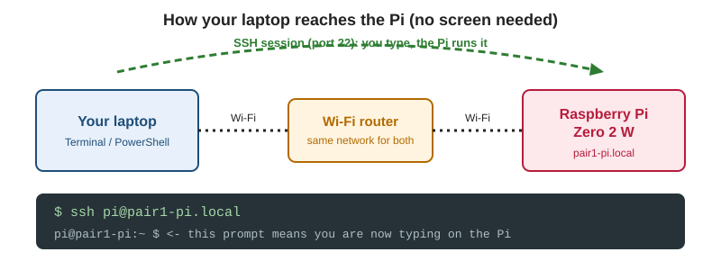

# Raspberry Pi and Arduino: a three-week lesson guide

You already know how to blink, sense and move things with an Arduino. Over nine sessions you will add a **Raspberry Pi Zero 2 W** to the robot and build one connected project: the **connected ultrasonic monitor**.

The Arduino keeps doing what it is good at: timing the sensor and moving the servo. The Pi does what *it* is good at: receiving the measurements, checking them, saving them and showing them. Each session has its own guide in `lessons/`. The circuit diagrams are in `circuits/`.



## The nine sessions

| Week | Session | Guide | You finish with |
| --- | --- | --- | --- |
| 1 | 1 | [Entry check, Pi access and Linux basics](lessons/01-pi-access-linux-basics/README.md) | Log in, find the project, run it, shut down safely |
| 1 | 2 | [Python project structure and environment](lessons/02-python-project-structure/README.md) | A virtual environment and three separate modules |
| 1 | 3 | [Git branches and first code review](lessons/03-git-branches-code-review/README.md) | One reviewed, merged change per teacher |
| 2 | 4 | [Arduino timing and sensor messages](lessons/04-arduino-timing-sensor-messages/README.md) | A non-blocking sketch sending `DIST,42.6` lines |
| 2 | 5 | [USB serial and data validation](lessons/05-usb-serial-validation/README.md) | The Pi reads, validates and survives a pulled cable |
| 2 | 6 | [Fault handling and repeatable tests](lessons/06-fault-handling-tests/README.md) | Parser tests and troubleshooting notes |
| 3 | 7 | [Timestamped data logging](lessons/07-timestamped-data-logging/README.md) | A CSV log, one graph, one observation |
| 3 | 8 | [Cleanup and classroom-ready instructions](lessons/08-cleanup-instructions-dashboard/README.md) | A README another pair can follow (+ optional dashboard) |
| 3 | 9 | [Proficiency check and teach-back](lessons/09-proficiency-check-teach-back/README.md) | Evidence of independent skill, and one taught activity |

## The big picture

```
 HC-SR04 sensor --> Arduino --USB serial--> Pi (Python) --> CSV file --> graph / dashboard
 servo <------------ Arduino                  read -> validate -> save
 (the Arduino owns the sensor and the servo; the Pi never touches the servo)
```

## How each session works

- **Pairs and roles.** Work in pairs and swap roles at every *Swap roles* marker.

  | Role | Job |
  | --- | --- |
  | Driver | Hands on the keyboard or the wires |
  | Reviewer | Reads the guide aloud and checks every step before it is done |
  | Troubleshooter | Reads error messages, checks cables, logs and tests |

- **Each guide has the same shape:** What you need, numbered Parts, a **Session output** checklist (your evidence that you can move on), Troubleshooting, a Challenge, and an individual **Checkpoint**.
- **Time.** The guides assume roughly two hours per session. Parts are marked with a time guide, so trim the Challenge first if you run short.

## The power plan (read this once)

```
Pi  --micro-USB OTG + USB cable-->  Arduino   (the brain: logic, signals, 5 V for the sensor)
4 x AA (6 V) pack                -->  servo     (the muscle: heavy current)
Arduino GND ---- battery pack −                (the common ground that joins them)
```

If you have read the motors guide, this is exactly the same idea: **separate supply for the heavy current, one common ground**. A servo that pulls current from the Arduino 5V pin while the Arduino hangs off a Pi Zero's USB port can reset the Arduino or crash the Pi.

## What is in this package

```
circuits/             diagrams used by the guides
lessons/              the nine session guides
starter-repo/         what each pair's repository contains on day one
reference-solution/   the finished project (facilitator copy)
```

Every code listing in the guides is also in `reference-solution/` so facilitators can run it.

## Preparing before Week 1

- **Pi image.** Use Raspberry Pi Imager and choose *Raspberry Pi OS Lite (64-bit)*. In the settings screen set the **hostname** (`pair1-pi`, `pair2-pi`, ...), a **username and password**, your **Wi-Fi network** and **enable SSH**. Follow the [Pi image setup and SSH guide](lessons/00-platform-bring-up-for-pi/settingup.md), then boot every Pi once and confirm you can `ssh` into it. The first boot can take a few minutes.
- **Python.** The image ships with Python 3 and `venv`. The guides use Python 3.11 or newer.
- **Git access.** Create one remote repository per pair from `starter-repo/`. Give each Pi a way to push: either a personal access token (HTTPS) or a per-pair SSH deploy key with write access. Lesson 3 needs push rights.
- **Arduino IDE** on each laptop. Sketches are uploaded **from the laptop**, not from the Pi.
- **Robots.** Test each Arduino, HC-SR04, servo, USB **data** cable and AA battery pack. Wiring is in [`circuits/robot_wiring.svg`](circuits/robot_wiring.svg).
- **Adapters.** Each Pi Zero 2 W needs a *micro-USB OTG adapter* plus a USB-A to USB-B cable. Check whether your Pi has a GPIO header fitted: the core project does not use it.
- **Offline fallback.** `reference-solution/arduino/simulated_sender/` makes an Arduino send realistic lines with no sensor attached. It also creates faults on purpose.
- **Network.** Make sure laptops and Pis share the same network. Check that `ping pair1-pi.local` works from a laptop.

## Further reading

- [Raspberry Pi getting started](https://www.raspberrypi.com/documentation/computers/getting-started.html)
- [Raspberry Pi Zero documentation](https://www.raspberrypi.com/documentation/computers/zero.html)
- [Arduino language reference](https://docs.arduino.cc/language-reference/)
- [Python virtual environments](https://docs.python.org/3/library/venv.html)
