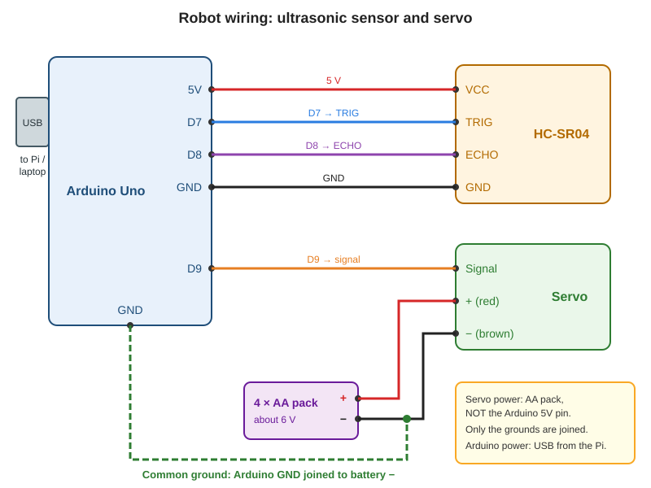

# Session 4: Arduino timing and sensor messages

This week the Pi meets the robot. Before they can talk, the Arduino has to be a good citizen: it needs to measure distance **and** move the servo smoothly at the same time, and then report each reading in a clean, predictable format.

Today you will fix the thing that makes most beginner robots feel sluggish: `delay()`. You will replace it with a pattern based on `millis()`, and finish with a robot that sends one tidy line per reading, like `DIST,42.6`.

The code is written for an Arduino Uno with an HC-SR04 and a hobby servo (SG90 or similar). The wiring diagram is in the `circuits/` folder. You upload sketches from your **laptop**, not from the Pi.

## What you need

- Arduino Uno and a USB cable, connected to your **laptop** today
- HC-SR04 ultrasonic sensor
- A hobby servo (SG90 or similar)
- Breadboard and jumper wires
- Battery holder with 4 AA batteries (about 6 V)
- The Arduino IDE (or Arduino Cloud editor) on your laptop
- Your project repository (the sketch goes in `arduino/`)

> **Roles today:** Driver (wires and IDE), Reviewer (checks every wire against the diagram), Troubleshooter (reads the serial monitor).

---

## Part 0: Why `delay()` is a problem

Imagine you put pasta on to boil and then stand and stare at the pot for ten minutes. You cannot stir the sauce, set the table or answer the phone. That is `delay()`: the Arduino does *nothing else* while it waits.

The alternative is a kitchen timer. You note the time, go and do other jobs, and glance at the clock every now and then. When enough time has passed, you act. In Arduino code the clock is `millis()`, which tells you how many milliseconds have passed since the board started.

```cpp
unsigned long last = 0;

void loop() {
  unsigned long now = millis();
  if (now - last >= 100) {     // has 100 ms passed?
    last = now;
    // do the 100 ms job
  }
  // ...other jobs can run here, freely
}
```

Two things to notice:

- `now - last` is the **elapsed time**. Using subtraction keeps working even when `millis()` wraps round to zero after about 49 days.
- Every job has its own `last` variable, like its own kitchen timer.

---

## Part 1: Wire the robot (and write it down)



| From | To |
| --- | --- |
| Arduino 5V | HC-SR04 VCC |
| Arduino D7 | HC-SR04 TRIG |
| Arduino D8 | HC-SR04 ECHO |
| Arduino GND | HC-SR04 GND |
| Arduino D9 | Servo signal (orange or yellow) |
| Battery pack + | Servo + (red) |
| Battery pack − | Servo − (brown or black) |
| Arduino GND | Battery pack − (**common ground**) |

The servo takes its **power** from the battery pack and its **instructions** from the Arduino. They meet at the common ground. This is the same idea as in the motors guide. Everything stays on the Arduino side: the Pi will never wire to the sensor or the servo.

The ECHO pin gives out 5 V. That is fine for an Arduino, but you must **never** wire it directly to a Raspberry Pi pin, which only tolerates 3.3 V.

1. Build the circuit from the table. The reviewer ticks off each row, and the driver touches each wire as it is checked.
2. Copy the table into `docs/wiring.md` in your repository.
3. Check with a multimeter that battery + to battery − reads about 6 V, and that Arduino GND beeps through to battery − (continuity).

**Swap roles.**

---

## Part 2: Find the blocking waits

Here is a typical first version of the robot's sketch. Upload it and watch what happens.

```cpp
#include <Servo.h>

Servo scanner;
const int TRIG_PIN = 7;
const int ECHO_PIN = 8;

float readDistanceCm() {
  digitalWrite(TRIG_PIN, LOW);
  delayMicroseconds(2);
  digitalWrite(TRIG_PIN, HIGH);
  delayMicroseconds(10);
  digitalWrite(TRIG_PIN, LOW);
  unsigned long duration = pulseIn(ECHO_PIN, HIGH, 30000);
  if (duration == 0) return -1.0;
  return duration * 0.0343 / 2.0;
}

void setup() {
  pinMode(TRIG_PIN, OUTPUT);
  pinMode(ECHO_PIN, INPUT);
  Serial.begin(9600);
  scanner.attach(9);
}

void loop() {
  for (int angle = 0; angle <= 180; angle++) {
    scanner.write(angle);
    delay(15);
  }
  for (int angle = 180; angle >= 0; angle--) {
    scanner.write(angle);
    delay(15);
  }
  float distance = readDistanceCm();   // only once per full sweep!
  Serial.println(distance);
  delay(500);
}
```

Open the serial monitor (9600 baud). A reading appears only about once every **6 seconds**, because the two `for` loops use `delay(15)` 362 times and then there is another `delay(500)`.

**Task:** with a highlighter or a pencil, mark every wait in the sketch that stops the robot from sampling the sensor or moving the servo. There are three places.

<details>
<summary>Answer</summary>

1. `delay(15)` inside the first `for` loop
2. `delay(15)` inside the second `for` loop
3. `delay(500)` at the end of `loop()`

(`delayMicroseconds(2)` and `delayMicroseconds(10)` are tiny and *required* by the sensor, so they stay. `pulseIn` also waits, but only for the echo. See the note below.)
</details>

---

## Part 3: Replace the waits with a state-based sketch

The new idea: `loop()` runs over and over, very fast. Each time round it asks two questions: "Is it time to move the servo?" and "Is it time to take a reading?" The servo's current angle and direction are the **state** the sketch remembers between turns.

```cpp
// Connected ultrasonic monitor: robot side (Arduino Uno)
// Reads an HC-SR04 and sweeps a servo WITHOUT blocking delay() calls.
// Sends one line per valid reading over USB serial, e.g.  DIST,42.6

#include <Servo.h>

const int TRIG_PIN  = 7;
const int ECHO_PIN  = 8;
const int SERVO_PIN = 9;

const unsigned long SENSOR_INTERVAL_MS = 100;   // 10 readings per second
const unsigned long SERVO_INTERVAL_MS  = 15;    // one degree every 15 ms
const unsigned long ECHO_TIMEOUT_US    = 30000; // give up after 30 ms (about 5 m)

Servo scanner;
int angle = 0;
int angleStep = 1;
unsigned long lastSensorMs = 0;
unsigned long lastServoMs  = 0;

// Returns the distance in cm, or -1.0 if no echo came back in time.
float readDistanceCm() {
  digitalWrite(TRIG_PIN, LOW);
  delayMicroseconds(2);
  digitalWrite(TRIG_PIN, HIGH);          // 10 microsecond trigger pulse
  delayMicroseconds(10);
  digitalWrite(TRIG_PIN, LOW);

  unsigned long duration = pulseIn(ECHO_PIN, HIGH, ECHO_TIMEOUT_US);
  if (duration == 0) {
    return -1.0;
  }
  return duration * 0.0343 / 2.0;        // speed of sound, there and back
}

void setup() {
  pinMode(TRIG_PIN, OUTPUT);
  pinMode(ECHO_PIN, INPUT);
  Serial.begin(9600);
  scanner.attach(SERVO_PIN);
  scanner.write(angle);
}

void loop() {
  unsigned long now = millis();

  // Job 1: move the servo one small step when it is due
  if (now - lastServoMs >= SERVO_INTERVAL_MS) {
    lastServoMs = now;
    angle += angleStep;
    if (angle >= 180 || angle <= 0) {
      angleStep = -angleStep;            // turn round at the ends
    }
    scanner.write(angle);
  }

  // Job 2: take a reading when it is due
  if (now - lastSensorMs >= SENSOR_INTERVAL_MS) {
    lastSensorMs = now;
    float distance = readDistanceCm();
    if (distance > 0) {                  // only valid readings are sent
      Serial.print("DIST,");
      Serial.println(distance, 1);
    }
  }
}
```

How it works:

- `angle` and `angleStep` hold the servo's **state**. Each step moves it by one degree, and at 0 or 180 the sign of `angleStep` flips so the servo turns round.
- The servo gets a new angle every 15 ms, and the sensor is read every 100 ms (10 readings a second). These are two independent timers.
- A reading is only sent if the echo came back (`distance > 0`), so an invalid reading never reaches the Pi.
- The Servo library keeps generating the servo pulses in the background, so the servo holds its position even while the sketch is doing something else.

> **An honest note about `pulseIn`.** It still waits for the echo, up to 30 ms. At 10 readings per second that is at most 30% of the time. When something is in range the wait is only a few milliseconds. It is a good compromise for our robot. A fully non-blocking sensor needs interrupts, which is an extension for another day.

**Message format.** The Pi will be able to check each line easily because it is always the same shape:

```
DIST,42.6
```

A tag, a comma, a number, and a newline at the end (`Serial.println`). Keep **servo control on the Arduino** and keep the format exactly like this, because the Pi's parser from Session 3 expects it.

---

## Part 4: Check the output

1. Upload the sketch. Keep the Arduino connected to your laptop.
2. Open the Serial Monitor at **9600 baud**.
3. Check that you see at least **10 consecutive lines** like this, with the numbers changing as you move your hand in front of the sensor:

   ```
   DIST,42.6
   DIST,42.5
   DIST,17.3
   DIST,16.9
   ```
4. Watch the servo at the same time. It should sweep smoothly and **keep sweeping** while readings flow.
5. Do the hand test: hold a flat book about 20 cm in front of the sensor and check that the reading is near 20.

**Record it.** Copy 10 consecutive lines into `docs/session4-sample.txt` and commit the sketch:

```
git add arduino/ docs/
git commit -m "Non-blocking sketch sends DIST lines"
```

(Save the sketch in `arduino/distance_sender/distance_sender.ino`. The Arduino IDE needs the folder and file to share the same name.)

---

## Session output

- [ ] Robot wired as in the diagram, with the wiring table in `docs/wiring.md`
- [ ] The three blocking waits identified and replaced
- [ ] At least 10 consecutive `DIST,xx.x` lines in the Serial Monitor
- [ ] The servo sweeps smoothly while readings keep arriving
- [ ] The sketch is committed, and servo control stays on the Arduino

---

## Troubleshooting

- **The Serial Monitor shows garbage characters:** the baud rate does not match. Set it to 9600.
- **Nothing is printed:** check that nothing is blocking the sensor, that TRIG is on D7 and ECHO on D8, and that the sensor has 5 V.
- **Readings are always missing or jumpy:** soft or angled surfaces (clothes, foam) absorb or deflect the sound. Try a flat book.
- **The servo jitters or the Arduino resets when it moves:** the servo is pulling current through the Arduino. Power it from the battery pack and check the common ground. A 100 µF capacitor across the servo's power and ground helps.
- **The servo does not move:** check that the signal wire is on D9 and that the battery pack is connected and fresh.
- **The servo is very slow:** the sweep speed is set by `SERVO_INTERVAL_MS`. Make it smaller to go faster.
- **The sketch will not upload:** check *Tools > Port* and that you picked the right board. Close any open Serial Monitor on the Pi.
- **Everything works on USB but fails on the Pi (Session 5):** check the AA pack is connected, since the Pi's USB port can't power a servo.

> **Challenge:** Make the servo **stop sweeping** whenever an object is closer than 15 cm, and carry on when it moves away. The readings must keep flowing the whole time.

---

## Checkpoint

Pair demo: show the Serial Monitor output with 10 lines of `DIST,xx.x`, and the servo sweeping at the same time. Each teacher explains in their own words why `millis()` works where `delay()` does not.

## Where to go next

The robot is now speaking a clean language. In **Session 5** you plug it into the Pi and teach Python to listen, check what it hears, and survive a pulled cable.

## Further reading

- [Arduino language reference: millis()](https://docs.arduino.cc/language-reference/)
- [Servo library](https://www.arduino.cc/reference/en/libraries/servo/)
- [pulseIn()](https://www.arduino.cc/reference/en/language/functions/advanced-io/pulsein/)
