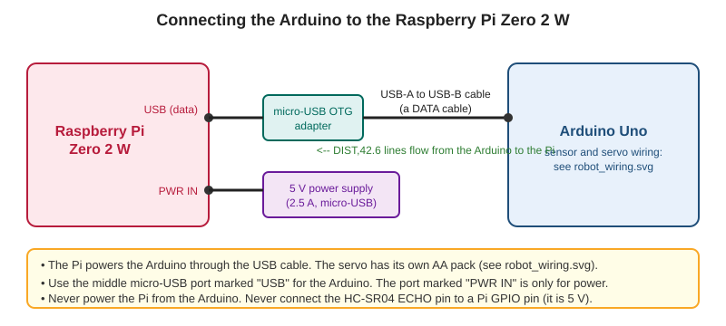

# Session 5: USB serial communication and data validation

The robot now speaks. Today the Pi learns to listen. You will connect the Arduino to the Pi with a USB cable, read its messages one line at a time in Python, and decide which ones to **trust**. Then you will do something every real system must survive: pull the cable out and plug it back in.

The wiring diagram is in the `circuits/` folder. No new wires on the robot today: only one USB cable between the Arduino and the Pi.

## What you need

- The Pi with your project and its virtual environment (Sessions 2 and 3)
- Your robot running the sketch from Session 4 (`DIST,xx.x` lines)
- A micro-USB OTG adapter and a USB-A to USB-B cable (a known-good **data** cable)
- The robot's AA battery pack connected as before
- No sensor? Upload `arduino/simulated_sender/simulated_sender.ino` instead. It sends realistic lines with nothing attached.

> **Roles today:** Driver, Reviewer, Troubleshooter. Swap at every **Swap roles** marker.

---

## Part 0: What is serial, and why USB?

**Serial** means sending data one character after another down a wire, like a very patient person reading a message aloud. Both sides must agree on the speed, called the **baud rate**. The Arduino sketch says `Serial.begin(9600)`, so the Pi must also open the port at 9600.

An Arduino Uno shows up on the Pi as a **serial device**: a file that behaves like a pipe. Reading it gives you what the Arduino printed.

```
Arduino  --USB cable-->  /dev/ttyACM0  --pyserial-->  your Python program
```

Because the messages are text lines ending in a newline, Python can read exactly one message at a time with `readline()`.

---

## Part 1: Connect and find the device



1. **Shut down the Pi first** if it is on (Session 1 procedure), then connect the cable. Use the middle port marked **USB**. The port marked **PWR IN** is only for power.
2. Power the Pi, wait for it to boot, and log in with SSH.
3. Find the serial device:

   ```
   ls /dev/ttyACM* /dev/ttyUSB*
   ```

   An original Uno usually appears as `/dev/ttyACM0`. A clone with a CH340 chip appears as `/dev/ttyUSB0`. If you see `No such file or directory` for both, nothing is detected. See Troubleshooting.
4. Check that your user is allowed to use it:

   ```
   groups
   ```

   The list should include `dialout`. If it does not, run `sudo usermod -aG dialout $USER`, then log out and back in.
5. If your device is not `/dev/ttyACM0`, change `SERIAL_PORT` in `pi/config.py`.

Quick check with no Python at all:

```
source .venv/bin/activate
python -m serial.tools.miniterm /dev/ttyACM0 9600
```

You should see `DIST,...` lines scrolling. Press `Ctrl+]` to quit.

**Swap roles.**

---

## Part 2: Read one line at a time in Python

Replace the pretend reader from Session 2 with a real one:

```python
"""Read lines from the Arduino over USB serial. Reconnects if the cable is pulled."""

import time

import serial
from serial import SerialException


def read_lines(port, baud, reconnect_delay=2.0, log=print):
    """Yield one decoded text line at a time, forever."""
    while True:
        try:
            log(f"Opening {port} at {baud} baud ...")
            with serial.Serial(port, baud, timeout=2) as connection:
                time.sleep(2)                    # an Uno restarts when the port opens
                connection.reset_input_buffer()
                log("Connected.")
                while True:
                    raw = connection.readline()
                    if not raw:
                        log("No data for 2 s. Is the sketch running?")
                        continue
                    yield raw.decode("utf-8", errors="replace").strip()
        except SerialException as error:
            log(f"Serial problem: {error}. Trying again in {reconnect_delay} s ...")
            time.sleep(reconnect_delay)
```

What it does:

- `read_lines()` is a **generator**: each time you ask for the next item, it yields one line of text.
- `timeout=2` means `readline()` gives up after two seconds if nothing arrives, so the program never hangs silently.
- `time.sleep(2)` after opening: an Arduino Uno **restarts when a program opens its serial port**, and needs a moment to boot.
- `reset_input_buffer()` throws away anything old, so you start on a fresh line.
- If the port fails (cable pulled), it prints a clear message, waits, and tries again.

Now a tiny diagnostic program that uses it. It prints every line and says whether the parser accepts it:

```python
"""Diagnostic tool: show every line from the Arduino and whether it is valid."""

from config import SERIAL_PORT, BAUD_RATE, RECONNECT_DELAY_S
from serial_reader import read_lines
from validator import parse_message, InvalidMessage


def main():
    try:
        for line in read_lines(SERIAL_PORT, BAUD_RATE, RECONNECT_DELAY_S):
            try:
                print(f"OK   {parse_message(line):6.1f} cm")
            except InvalidMessage as error:
                print(f"BAD  {error}")
    except KeyboardInterrupt:
        print("\nStopped.")


if __name__ == "__main__":
    main()
```

Run it from the project folder:

```
python pi/print_readings.py
```

You should see:

```
Opening /dev/ttyACM0 at 9600 baud ...
Connected.
OK     42.6 cm
OK     42.5 cm
OK     17.3 cm
```

Move your hand in front of the sensor and watch the numbers change. Press `Ctrl+C` to stop.

---

## Part 3: Reject what you cannot trust

The validator you wrote in Session 3 already does three checks. Each one protects the rest of the program:

| Check | Example | Why it matters |
| --- | --- | --- |
| Format | `HELLO` or `DIST,1,2` | Half a line can arrive if you connect mid-message |
| Number | `DIST,abc` | A garbled character would crash `float()` |
| Range | `DIST,9999.0` | A reading no sensor could produce is noise, not data |

Test it on live data. While `print_readings.py` runs, **briefly** pull the sensor's TRIG or ECHO wire. Watch what the sketch does (it should stop sending, because no echo returns). Replace it, and the lines resume.

Then open the sketch `arduino/simulated_sender/simulated_sender.ino`, set `FAULT_MODE = 1`, and upload it from your laptop. You should now see lines like this every 10 readings:

```
BAD  Bad format: 'DI@T;4x2'
```

Put `FAULT_MODE` back to 0 when you finish.

**Swap roles.**

---

## Part 4: Pull the cable

A program that only works while nothing goes wrong is not finished. With `print_readings.py` running:

1. Pull the USB cable out of the Arduino.
2. Read the message. It should say something like:

   ```
   Serial problem: ... Trying again in 2 s ...
   ```
3. Plug the cable back in.
4. Check that it prints `Connected.` and readings start again, **without** restarting the program.

If the program crashes instead, read the last lines of the error. Which line raised it? What kind of exception was it?

---

## Part 5: Draw the data path

On paper, without looking at this guide, draw the journey of **one measurement** from the sensor to the terminal. Include each of these, in order: HC-SR04, Arduino, USB cable, `serial_reader.py`, `validator.py`, terminal output. Label what travels along each arrow (a sound echo, a number in cm, a line of text, a float).

<details>
<summary>Check your drawing</summary>

```
HC-SR04 --echo pulse--> Arduino (pulseIn, converts µs to cm, prints "DIST,42.6")
        --text line over USB--> serial_reader.py (readline, decode)
        --string--> validator.py (parse_message -> float or InvalidMessage)
        --float--> terminal ("OK 42.6 cm")
```
</details>

Photograph the drawing and save it as `docs/data-path.jpg` (or `.png`).

---

## Session output

- [ ] You found the serial device and can name its path
- [ ] The Pi prints valid readings, and `BAD` lines for invalid ones
- [ ] Pulling and replacing the cable gives a clear message and an automatic recovery
- [ ] A drawing of the sensor-to-terminal data path is in `docs/`
- [ ] The new `serial_reader.py` and `print_readings.py` are committed

---

## Troubleshooting

- **No `/dev/ttyACM0` at all:** the cable may be charge-only. Try another known-good data cable. Check you used the **USB** port, not **PWR IN**, and that the OTG adapter is fully seated. Run `dmesg | tail` right after plugging in to see what the Pi detected.
- **`/dev/ttyUSB0` instead of `ttyACM0`:** change `SERIAL_PORT` in `config.py`.
- **`Permission denied: '/dev/ttyACM0'`:** add your user to the `dialout` group (see Part 1).
- **`could not open port ...: Device or resource busy`:** another program (like `miniterm`) still has the port open. Close it.
- **Readings appear, but garbled:** the baud rate in `config.py` does not match `Serial.begin()`.
- **"No data for 2 s. Is the sketch running?":** the Arduino is not sending. Check the sketch is uploaded, and that the sensor is returning echoes.
- **The Pi reboots or freezes when the servo moves:** the servo is drawing power through the Arduino. Power it from the AA pack (see the wiring diagram).
- **Each time you start the program there is a two-second wait:** that is expected. The Uno restarts when the port opens.
- **Output is slow:** a Pi Zero 2 W is small. 10 lines a second is easy for it, but running many programs at once can slow it.

> **Challenge:** Print a running count of valid and rejected lines every 10 lines, and show the minimum and maximum distance seen so far.

---

## Checkpoint

Each pair demonstrates live readings from the robot on the Pi. Each teacher explains why the Pi rejects `DIST,9999.0` even though it is perfectly formatted.

## Where to go next

Next session the faults come from **you**. In **Session 6** you will write tests for every kind of bad input, and break the system on purpose to practise finding the cause.

## Further reading

- [pyserial: short introduction](https://pyserial.readthedocs.io/en/latest/shortintro.html)
- [Raspberry Pi Zero documentation](https://www.raspberrypi.com/documentation/computers/zero.html)
- [Arduino Serial reference](https://www.arduino.cc/reference/en/language/functions/communication/serial/)
